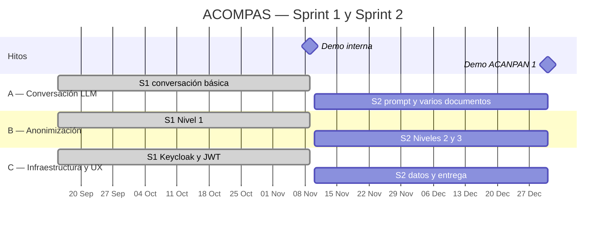

# Roadmap de ACOMPAS

> **Página derivada.** No decide y no es fuente de verdad: muestra lo que ya está
> decidido en otra parte. Cada fila cita su fuente. Si algo no coincide con la
> fuente, vale la fuente.
>
> **Estado de esta versión:** 23 de noviembre de 2026. Comprobada contra el
> Documento Operativo del Sprint 2 v0.4, la Arquitectura del Sistema v0.10, el
> Plan de Proyecto v0.22, los ADR-022 a ADR-028 (ADR-023 en `main`; el resto, en
> revisión) y el índice de ACO de `main`.

## Leyenda

| Estado | Significado |
| --- | --- |
| **Entregado** | En `main`, con su PR revisada |
| **En curso** | Empezado y aún no integrado |
| **Planificado** | Tiene sprint y alcance, pero no ha empezado |
| **Por decidir** | Depende de una decisión abierta |

El estado de cada ACO **no se repite aquí**: vive en [`docs/indice.md`](indice.md),
que se genera de `docs/aco/sprints.toml` y la CI comprueba. El estado vivo del
sprint está en el [tablero del proyecto](https://github.com/users/ACOMPAS-IA/projects/1).

## 1. Qué puede hacer el paciente en cada hito

*(Plan de Proyecto §4; Casos de Uso; 01-PRODUCTO §5)*

| Hito | Fecha | Qué puede hacer el paciente |
| --- | --- | --- |
| Acuerdo con ACANPAN e infraestructura | sep 2026 | Nada todavía: bases técnicas, legales y humanas |
| **Demo interna** | **9 nov 2026** | Subir un informe **sintético**, ver qué datos se han sustituido y preguntar sobre él |
| **Demo ACANPAN 1** | **dic 2026** | Usar **documentos reales** por primera vez, con anonimización completa y derecho al olvido; si la anonimización no llega, se aplica el plan B (§4) |
| — | dic 2026 – ene 2027 | Volver a sus conversaciones, ver la fuente de la respuesta, preguntas sugeridas y panel básico |
| **Demo ACANPAN 2** | **mar 2027** | Preguntar con fuentes del RAG y motor de contexto |
| — | mar – abr 2027 | Exportar un resumen clínico a PDF con sus preferencias |
| **MVP** | **15 jul 2027** | Flujo completo, probado con 5–10 casos reales |
| RAG operativo | sep – dic 2027 | El RAG funciona con trazabilidad y métricas de calidad |
| — | 2028 | Validación clínica informal y financiación |

Parada de verano: del 15 de julio al 1 de septiembre de cada año. El MVP cae
justo antes de la parada de 2027. *(Plan de Proyecto §4)*

## 2. Sprints, pistas e hitos

El Gantt cubre el Sprint 1 y el Sprint 2, que son los únicos con fechas y trabajo
definidos. A partir del S3 solo hay rangos aproximados por meses, y dibujarlos
sería inventar precisión: están en la tabla 3.3.

Las pistas son las tres de la Arquitectura §14 y del Plan de Proyecto: **A**
(conversación LLM), **B** (anonimización) y **C** (infraestructura y UX). No hay
una cuarta.



### Nota sobre las fechas

- **S1: 15 sep – 9 nov 2026** (ocho semanas), con el cierre el **12 de
  noviembre** y la decisión conjunta #137. Las fechas de fin previsto (27 oct) y
  fin real (9 nov) son las del registro de desviaciones. *(Documento Operativo
  Sprint 1 §5; 08-PLAN §1; `docs/desviaciones.md`)*
- **S2: 10 nov – 31 dic 2026.** *(Documento Operativo Sprint 2 §8)*
- La demo de ACANPAN figura como «dic 2026»; **el día no está fijado en ninguna
  fuente**. El hito se dibuja el 31 de diciembre como marcador de mes, y la
  fecha se fija en #161.
- El Plan de Proyecto etiqueta el S1 como «sep–nov» y el S2 como «oct–dic»:
  **se solapan en octubre**. Son rangos aproximados de fase, no fechas de
  sprint. El Gantt dibuja las fechas documentadas y no el solape.

## 3. Qué se construye en cada sprint

### 3.1. Sprint 1

*(Arquitectura §14, fila S1; Documento Operativo Sprint 1 §14)*

| Pista | Contenido | Estado |
| --- | --- | --- |
| **A — Conversación LLM** | Conversación básica: Claude responde sobre un informe oncológico sintético | Entregado: ACO-027 a 031, 051 y 052 |
| **B — Anonimización** | Nivel 1: Presidio básico, etiquetado automático y validación con umbral de hallazgo y de documento (ADR-013) | Entregado: ACO-020 a 026 |
| **C — Infraestructura y UX** | Keycloak con 2FA y OAuth2/OIDC; JWT en todas las peticiones; lista blanca de correos; frontend y cliente de API | Entregado: ACO-011 a 019 y 032 |

ACO-033 (pruebas de extremo a extremo) no llegó al S1: depende de ACO-032, de
ACO-034 y de ADR-019. Se **traspasó al S2** con excepción autorizada por la
decisión conjunta #137, y es la única fila del S1 que no figura como hecha.

### 3.2. Sprint 2

*(Documento Operativo Sprint 2 §6 y §7; Arquitectura §14, fila S2)*

Los 19 ACO del sprint, agrupados por los paquetes de trabajo que fija el
Documento Operativo §7. El paquete es del Documento Operativo; el Gantt dibuja
las pistas de la Arquitectura. **No se corresponden uno a uno**: la Arquitectura
agrupa por pista técnica y el Documento Operativo por área de trabajo del sprint.
El §6 no asigna cada ACO a un paquete: la colocación de cada fila se ha hecho
por su objeto.

Lo que se construye se resume de los títulos de esos ACO. La fila del S2 de la
Arquitectura §14 añade la base de conocimiento estática y la preparación del
RAG, que el Documento Operativo deja fuera del sprint; no se incluyen aquí.

| Paquete | Qué se construye | ACO | Horas |
| --- | --- | --- | --- |
| **Plataforma e infraestructura** | Imagen del backend con PyTorch en CPU y los modelos cargados al arrancar; VPS con el frontend servido desde el build de producción; entorno de staging; cierre de la seguridad de los tokens (lista negra, rotación y renovación entre llamadas); pruebas de extremo a extremo con su fixture de usuario autenticado | 033, 034, 047, 053, 054, 055 | 39–52 h |
| **Anonimización** | OCR local para los documentos escaneados y validación reforzada del Nivel 2; Nivel 3, donde el paciente tapa el dato que se le escapó; métricas de cobertura; modelo de datos definitivo con UUID y etiquetas anonimizadas | 035, 036, 037, 038 | 34–46 h |
| **Conversación** | Clasificador de intención antes de llamar al modelo; prompt refinado y defensa frente a la inyección de instrucciones; varios documentos por paciente: guardado del anonimizado, cita en la respuesta y atribución con varias fuentes | 041, 042, 043, 044, 045 | 30–40 h |
| **Datos y cumplimiento** | Registro de auditoría de accesos y operaciones sensibles; borrado por documento y derecho al olvido, verificable | 039, 040 | 20–26 h |
| **Demo y entrega** | Interfaz del paciente: portada, textos y estados; recorrido de la demo, textos y ensayo | 046, 056 | 12–16 h |

Los 19 ACO suman ≈158 h. Con los ADR (≈21 h) y las revisiones, la carga
comprometida es de **≈194 h sobre un techo de ≈264 h (el 74 %)**: quedan ≈70 h
sin asignar, más que el colchón del 20 %. Si el colchón se consume a mitad de
sprint, se aplica la regla de recorte de #144: las fechas de la demo y de
ACANPAN no se mueven. *(Documento Operativo Sprint 2 §8)*

La revisión de mitad de sprint es el **4 de diciembre**, de 15 minutos, con el
semáforo por ACO y anotada en #168. *(Documento Operativo Sprint 2 §9)*

Las fichas de ACO-034, 041, 047 y 053 van en la PR #188; el resto espera a que
su ADR entre en `main`.

### 3.3. Del Sprint 3 en adelante

*(01-PRODUCTO §5; el detalle por ACO no existe todavía)*

| Fase | Fechas | Objetivo | Estado |
| --- | --- | --- | --- |
| **S3** | dic 2026 – ene 2027 | Historial persistente, preguntas sugeridas, cita de fuente, panel básico; integración inicial del RAG | Por decidir |
| **S4** | ene – mar 2027 | Motor de contexto optimizado; RAG completo | Por decidir |
| **S5** | mar – abr 2027 | Resumen clínico exportable a PDF con preferencias editables; panel completo | Por decidir |
| **S6** | abr – jul 2027 | Integración completa; pruebas con 5–10 casos reales; cierre de la anonimización | Por decidir |
| **Fase 1.5** | sep – dic 2027 | RAG operativo, trazabilidad y métricas de calidad | Por decidir |
| **Fase 2** | 2028 | Validación clínica informal y financiación | Por decidir |

«Por decidir» no significa que no esté planificado: significa que **no hay fichas
ACO ni fechas cerradas**, solo el objetivo del Plan de Proyecto.

## 4. Qué depende de qué

*(08-PLAN §3; Documento Operativo Sprint 2 §6; fichas ACO)*

```
S1 identidad:       011 → 012 → 013 → 014 → 015
S1 frontend y API:  016 → 017/018 → 019
S1 anonimización:   020 → 021 → 022 → 023 → 024 → 025 → 026
S1 conversación:    027 → 028/030;  029 → 030 → 031

S2 datos:           ADR-022 → 038 → 039 / 040 / 043
S2 anonimización:   ADR-023 → 035 → 036 (Nivel 3) → demo
                    ADR-027 → 036
S2 conversación:    ADR-006 → 041;  ADR-028 → 042
                    043 → 044 → 045 → 046
S2 entrega:         053 + 054 + 055 → 056
E2E:                032 (hecho) + 034 + ADR-019 → 033
```

**Puntos de entrega entre personas:** el cliente de API (ACO-019) y la
conversación (ACO-030) acuerdan el contrato antes de integrarse en ACO-032. Lo
mismo con la API de anonimización (ACO-024) y la conversación.

**Dependencias que no están en las cadenas:**

| Trabajo | Depende de |
| --- | --- |
| Documentos reales (demo de diciembre) | Anonimización completa (Niveles 1 a 3), derecho al olvido y auditoría. El ADR-027, en revisión, fija que el Nivel 3 forma parte de la anonimización; si la anonimización no llega a tiempo, se aplica el plan B de la Arquitectura (documentos ya anonimizados fuera) |
| Demo ACANPAN (ACO-056) | ACO-053, ACO-054, ACO-055 y la fecha de #161 |
| RAG completo (S4) | El calendario del RAG y con qué corpus trabaja (cuestión abierta) |
| Conversar sin documento (S3+) | El clasificador (ACO-042) y los topes de gasto (S3); el ACO que modifique ACO-030 §8.1 (#170; #145) |

## 5. Decisiones y riesgos que pueden mover las fechas

| Riesgo o decisión | Qué puede mover | Estado | Fuente |
| --- | --- | --- | --- |
| ADR del modelo de datos | ACO-038, y con él auditoría, borrado y guardado | En revisión | [#190](https://github.com/ACOMPAS-IA/acompas/pull/190) |
| ADR del registro de auditoría | ACO-039 y el uso de datos reales | En revisión | [#195](https://github.com/ACOMPAS-IA/acompas/pull/195) |
| ADR del derecho al olvido | ACO-040 y el uso de datos reales | En revisión | [#197](https://github.com/ACOMPAS-IA/acompas/pull/197) |
| ADR de contratación del VPS | ACO-054, 055 y 056 | En revisión | [#199](https://github.com/ACOMPAS-IA/acompas/pull/199) |
| ADR del Nivel 3 | ACO-036 y el uso de documentos reales | En revisión | [#201](https://github.com/ACOMPAS-IA/acompas/pull/201) |
| ADR del clasificador de intención | ACO-042 | En revisión: ADR-028, antes del 25 de noviembre | [#203](https://github.com/ACOMPAS-IA/acompas/pull/203); DO Sprint 2 §6 |
| Clave del proyecto y límite de gasto | La demo con documentos reales | Abierto | #92 |
| Fecha de la demo | ACO-056 y el ensayo | Sin fijar | #161 |
| Documentos reales o plan B | Qué se enseña y a quién | Abierto | #161 |
| Calendario del RAG y corpus | S3 y S4 | Cuestión abierta | 01-PRODUCTO |
| Tono del LLM (D9) | S2, prompt refinado | Cuestión abierta | 01-PRODUCTO |
| Fase orientativa de los casos de uso | El sprint de UC-08, UC-23 y UC-24 | Cuestión abierta | 01-PRODUCTO |
| Parada de verano (15 jul – 1 sep) | El MVP del 15 de julio cae justo antes | Planificado | Plan de Proyecto §4 |
| Etiquetas de sprint solapadas | La lectura de las fechas | Hallazgo sobre el Plan | Plan de Proyecto §4 |

Cerradas desde la versión anterior: el cierre del S1 (#137), el índice generado
(#140), el colchón y la regla de recorte (#144), el límite y la retención de
documentos (#138), el clasificador de intención (#169, que pasa a ACO-042) y el
ADR del motor de OCR (ADR-023, #192).
ADR-019 y ADR-020 están aprobados.

## 6. Cómo se mantiene

1. **Se actualiza al cerrar cada sprint** y cuando se cierra una decisión de la
   vista 5.
2. **Cada fila cita su fuente.** Si una fuente cambia, se sabe qué mirar.
3. **No repite el detalle de los ACO.** Dice *qué* se construye; el estado de
   cada ficha vive en [`docs/indice.md`](indice.md), y el estado vivo del sprint,
   en el tablero del proyecto.
4. **No es fuente de verdad.** Si el roadmap y una ficha no coinciden, vale la
   ficha.
