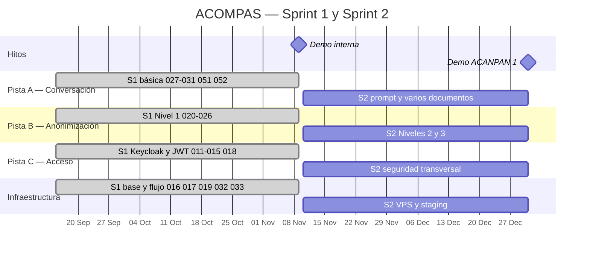

# Roadmap de ACOMPAS

> **Página derivada.** No decide y no es fuente de verdad: muestra lo que ya está
> decidido en otra parte. Cada fila cita su fuente. Si algo no coincide con la
> fuente, vale la fuente.
>
> Se actualiza al cerrar cada sprint, junto con el índice.

## Leyenda

| Estado | Significado |
| --- | --- |
| **Entregado** | En `main`, con su PR revisada |
| **En curso** | Empezado y aún no integrado |
| **Planificado** | Tiene sprint y alcance, pero no ha empezado |
| **Por decidir** | Depende de una decisión abierta |

## 1. Qué puede hacer el paciente en cada hito

*(Plan de Proyecto §4; Casos de Uso; 01-PRODUCTO §5)*

| Hito | Fecha | Qué puede hacer el paciente |
| --- | --- | --- |
| Acuerdo con ACANPAN e infraestructura | sep 2026 | Nada todavía: bases técnicas, legales y humanas |
| **Demo interna** | **9 nov 2026** | Subir un informe **sintético**, ver qué datos se han sustituido y preguntar sobre él |
| **Demo ACANPAN 1** | **dic 2026** | Usar **documentos reales** por primera vez, con anonimización completa y derecho al olvido |
| — | dic 2026 – ene 2027 | Volver a sus conversaciones, ver la fuente de la respuesta, preguntas sugeridas y panel básico |
| **Demo ACANPAN 2** | **mar 2027** | Preguntar con fuentes del RAG y motor de contexto |
| — | mar – abr 2027 | Exportar un resumen clínico a PDF con sus preferencias |
| **MVP** | **15 jul 2027** | Flujo completo, probado con 5–10 casos reales |
| RAG operativo | sep – dic 2027 | El RAG funciona con trazabilidad y métricas de calidad |
| — | 2028 | Validación clínica informal y financiación |

Parada de verano: del 15 de julio al 1 de septiembre de cada año. El MVP cae
justo antes de la parada de 2027. *(Plan de Proyecto §4)*

## 2. Sprints, pistas e hitos

El Gantt cubre el Sprint 1 y el Sprint 2, que son los únicos con fechas y trabajo
definidos. A partir del S3 solo hay rangos aproximados por meses, y dibujarlos
sería inventar precisión: están en la tabla 3.2.



### Nota sobre las fechas

- **S1: 15 sep – 9 nov 2026.** El inicio consta en 08-PLAN §3 y el final es la
  demo del 9 de noviembre.
- **S2: 10 nov – 31 dic 2026.** Empieza el día siguiente a la demo y termina en
  el mes de la demo de ACANPAN.
- El Plan de Proyecto etiqueta el S1 como «sep–nov» y el S2 como «oct–dic»:
  **se solapan en octubre**. Son rangos aproximados de fase, no fechas de
  sprint. El Gantt dibuja las fechas documentadas y no el solape.
- La demo de ACANPAN figura como «dic 2026»; **el día no está fijado en ninguna
  fuente**. El hito se dibuja el 31 de diciembre como marcador de mes.

## 3. Qué se construye en cada sprint

### 3.1. Sprint 1 y Sprint 2 por pista

Las pistas A, B y C son las de 05-DISEÑO. **Infraestructura** es una agrupación
de este roadmap para el S2 en adelante (VPS, staging, CI), no una pista del
arnés.

| Sprint | Estado | Pista A — Conversación | Pista B — Anonimización | Pista C — Acceso | Infraestructura |
| --- | --- | --- | --- | --- | --- |
| **S1** | **Entregado**, salvo ACO-033 | 027, 028, 029, 030, 031, 051, 052 | 020, 021, 022, 023, 024, 025, 026 | 011, 012, 013, 014, 015, 018 | 016, 017, 019, 032, 033 |

ACO-033 (E2E) no llegó al S1: depende de #63 (PyTorch) y #117 (modelos
horneados). Su traslado al S2 lo decide #137.

**S2 — planificado, sin fichas todavía.** Los bloques están en 08-PLAN §4:

- **ACO-035 a 046:** OCR, Niveles 2 y 3, métricas, modelo de datos definitivo,
  auditoría, borrado, prompt injection y límites del LLM.
- **ACO-053 a 056:** seguridad transversal, VPS, staging y demo de ACANPAN.

**El reparto de esos bloques por pista se decide en la planificación del S2**
(#144), no aquí. Lo que ya se sabe que entra:

| Trabajo | Origen |
| --- | --- |
| E2E de ACO-033 | #137 |
| Varios documentos: guardado, cita y contradicciones | #139 |
| Límite de documentos por usuario | #138 |
| Rotación de refresh tokens y CSP | #73, #77 |
| Renovación de token entre llamadas concurrentes | #122 |

### 3.2. Del Sprint 3 en adelante

*(01-PRODUCTO §5; el detalle por ACO no existe todavía)*

| Fase | Fechas | Objetivo | Estado |
| --- | --- | --- | --- |
| **S3** | dic 2026 – ene 2027 | Historial persistente, preguntas sugeridas, cita de fuente, panel básico; integración inicial del RAG | Por decidir |
| **S4** | ene – mar 2027 | Motor de contexto optimizado; RAG completo | Por decidir |
| **S5** | mar – abr 2027 | Resumen clínico exportable a PDF con preferencias editables; panel completo | Por decidir |
| **S6** | abr – jul 2027 | Integración completa; pruebas con 5–10 casos reales; cierre de la anonimización | Por decidir |
| **Fase 1.5** | sep – dic 2027 | RAG operativo, trazabilidad y métricas de calidad | Por decidir |
| **Fase 2** | 2028 | Validación clínica informal y financiación | Por decidir |

«Por decidir» no significa que no esté planificado: significa que **no hay fichas
ACO ni fechas cerradas**, solo el objetivo del Plan de Proyecto.

## 4. Qué depende de qué

*(08-PLAN §3; fichas ACO)*

```
Identidad:        011 → 012 → 013 → 014 → 015
Frontend/API:     016 → 017/018 → 019
Anonimización:    020 → 021 → 022 → 023 → 024 → 025 → 026
Conversación:     027 → 028/030;  029 → 030 → 031
E2E:              019 + 024 + 030 → 032 → 033
Demo:             051 + 052 alimentan la validación de 032/033
```

**Puntos de entrega entre personas:** el cliente de API (019, Miguel) y la
conversación (030, Luis) acuerdan el contrato antes de integrarse en 032. Lo
mismo con la API de anonimización (024) y la conversación.

**Dependencias que no están en las cadenas:**

| Trabajo | Depende de |
| --- | --- |
| ACO-033 (E2E) | #63 (`torch` CPU) y #117 (modelos horneados) |
| Documentos reales (S2) | Anonimización completa, derecho al olvido y auditoría |
| RAG completo (S4) | El calendario del RAG y con qué corpus trabaja (cuestión abierta) |
| Conversar sin documento (S3+) | Un ACO que modifique ACO-030 §8.1 (#145) |

## 5. Riesgos y decisiones que pueden mover las fechas

| Riesgo o decisión | Qué puede mover | Estado | Fuente |
| --- | --- | --- | --- |
| Cierre del S1 y bloque del S2 | El alcance del S2 y la fila del S1 de este roadmap | Decisión conjunta, vence el 13-N | #137 |
| Índice de ACO generado | El enlace al estado de cada ficha | Decisión conjunta, vence el 13-N | #140 |
| Colchón y regla de recorte | Cómo se lee este roadmap cuando algo se retrasa | Decisión conjunta, vence el 13-N | #144 |
| PyTorch estándar frente a CPU | Tamaño de la imagen y ACO-033 | Abierto | #63 |
| Modelos de anonimización en la imagen | Primera anonimización (~11 min) y ACO-033 | Abierto | #117 |
| Calendario del RAG y corpus | S3 y S4 | Cuestión abierta | 01-PRODUCTO |
| Tono del LLM (D9) | S2, prompt refinado | Cuestión abierta | 01-PRODUCTO |
| Fase orientativa de los casos de uso | El sprint de UC-08, UC-23 y UC-24 | Cuestión abierta | 01-PRODUCTO |
| Parada de verano (15 jul – 1 sep) | El MVP del 15 de julio cae justo antes | Planificado | Plan de Proyecto §4 |
| Etiquetas de sprint solapadas | La lectura de las fechas | Hallazgo de este documento | Plan de Proyecto §4 |

## 6. Cómo se mantiene

1. **Se actualiza al cerrar cada sprint**, junto con el índice. Es la línea que
   recoge la Definition of Done del S2 (#142).
2. **Cada fila cita su fuente.** Si una fuente cambia, se sabe qué mirar.
3. **No repite el detalle de los ACO.** Dice *qué* se construye; el estado de
   cada ficha vive en `docs/indice.md` (cuando #140 se apruebe) y, mientras
   tanto, en 08-PLAN §5.
4. **No es fuente de verdad.** Si el roadmap y una ficha no coinciden, vale la
   ficha.
